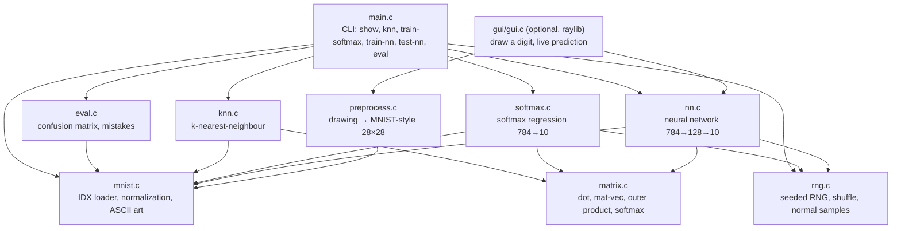
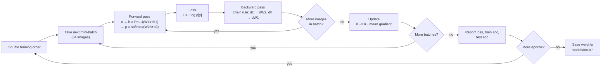

# Architecture

## Module structure

Each arrow means "uses". `main.c` is the only file that knows about the command line; every other module is a small library.

`gui/gui.c` is the only file that uses a library other than the C standard library (raylib). It lives outside `src/` so the core build (`make`) stays dependency-free; `make gui` builds it from `gui/gui.c` plus every `src/` file except `main.c`.

## Training loop (neural network)

## Data shapes at each step

For one image through the neural network ([`nn_forward`](../src/nn.c#L34)):

| Step | Formula | Shape |
|---|---|---|
| Raw file | bytes 0–255 | 28 × 28 |
| Input `x` | byte / 255 | 784 |
| Hidden pre-activation `h_pre` | `W1 · x + b1` | (128×784)·(784) + 128 → **128** |
| Hidden `h` | `max(0, h_pre)` | **128** |
| Logits `z` | `W2 · h + b2` | (10×128)·(128) + 10 → **10** |
| Probabilities `p` | `softmax(z)` | **10**, sums to 1 |
| Prediction | `argmax(p)` | one digit 0–9 |

Backward pass shapes ([`nn_backward`](../src/nn.c#L51)): `dz` 10 → `dW2` 10×128 → `dh` 128 → `dW1` 128×784. Each gradient has exactly the shape of the thing it adjusts.

Parameter count: 128·784 + 128 + 10·128 + 10 = **101,770**. Saved as 407,096 bytes (16-byte header + 101,770 × 4-byte floats).

## Role of every file

| File | Role |
|---|---|
| [src/main.c](../src/main.c) | Parses the command, loads datasets, calls the right module, frees everything. Holds file paths and the fixed seed (42). |
| [src/mnist.c](../src/mnist.c) / [.h](../src/mnist.h) | Reads big-endian IDX headers, validates them, converts pixels to floats in [0, 1], and prints images as ASCII. Defines `Dataset`. |
| [src/matrix.c](../src/matrix.c) / [.h](../src/matrix.h) | All the math primitives, hand-written: dot product, squared distance, matrix·vector, transposed matrix·vector, outer-product accumulate, scaled add, softmax, argmax. |
| [src/rng.c](../src/rng.c) / [.h](../src/rng.h) | xorshift64* generator, so results are identical on every machine. Uniform and normal samples and the Fisher–Yates shuffle. |
| [src/knn.c](../src/knn.c) / [.h](../src/knn.h) | Baseline with no learning: the k closest training images vote. |
| [src/softmax.c](../src/softmax.c) / [.h](../src/softmax.h) | One linear layer + softmax, trained with mini-batch gradient descent. |
| [src/nn.c](../src/nn.c) / [.h](../src/nn.h) | Two-layer network: He init, forward pass, hand-written backprop, update, save/load. |
| [src/eval.c](../src/eval.c) / [.h](../src/eval.h) | Confusion matrix, most-confused pairs, ASCII prints of the most confident mistakes. Takes plain arrays of predictions, so it works with any model. |
| [src/preprocess.c](../src/preprocess.c) / [.h](../src/preprocess.h) | Turns a free-hand drawing into an MNIST-style input: crop to the ink, scale the longer side to 20 px, centre by centre of mass in 28×28. |
| [gui/gui.c](../gui/gui.c) | Optional raylib window: mouse drawing on a 280×280 canvas, live probability bars, preview of the 28×28 network input. |
| [Makefile](../Makefile) | `make`, `make debug` (AddressSanitizer), `make leakcheck`, `make data`, `make gui`. |
| [scripts/download_mnist.sh](../scripts/download_mnist.sh) | Downloads and unzips MNIST into `data/`. |

## Memory layout

Every matrix is one flat `float` array in **row-major** order: element (r, c) of a matrix with `cols` columns is `m[r * cols + c]`. The dataset is the same: image `i` starts at `images[i * 784]`. This keeps memory reads sequential, which is what makes the plain C loops fast.

## Drawing → prediction (GUI)

The network only ever saw MNIST digits, which were all cropped, scaled to fit 20×20 and centred by centre of mass in 28×28. A raw mouse drawing is a different size and in a different place, so without these steps accuracy drops sharply. As a check, I enlarged every test digit to a random size, put it at a random position on a 280×280 canvas, and ran it through `preprocess_canvas`: accuracy went from 97.51% to 97.48%.
